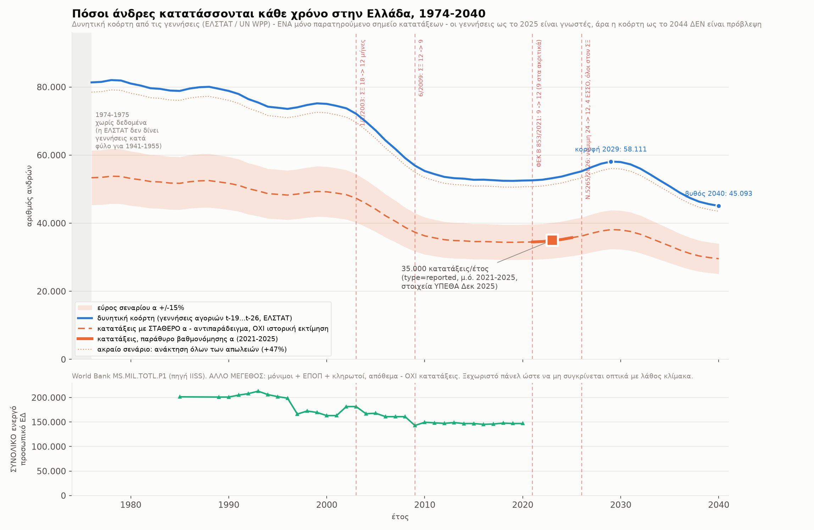
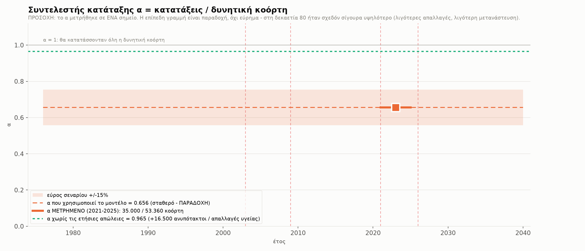
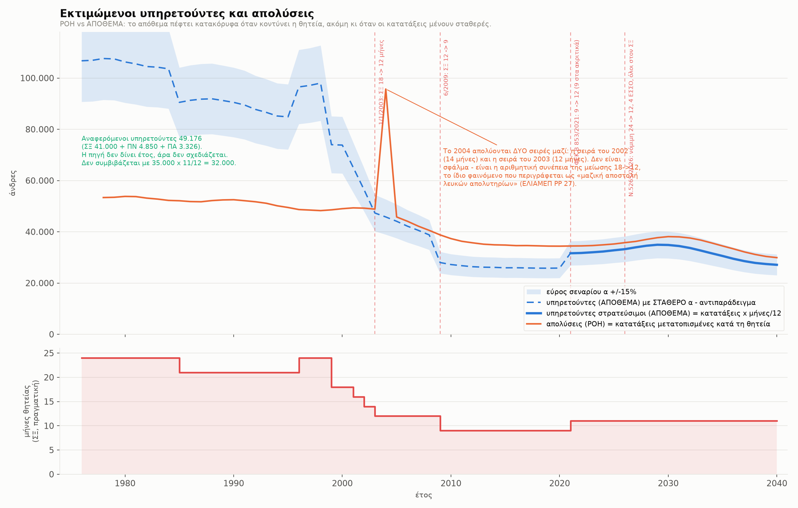

# Πόσοι άνδρες κατατάσσονται κάθε χρόνο στην Ελλάδα, 1974–2040

Data project για τις **κατατάξεις στρατευσίμων ανά ημερολογιακό έτος** στην Ελλάδα,
από τη Μεταπολίτευση μέχρι σήμερα, με προβολή ως το 2040.



---

## Το σημαντικότερο εύρημα είναι αρνητικό

**Ο αριθμός των κατατάξεων στρατευσίμων ανά έτος δεν δημοσιεύεται πουθενά στην
Ελλάδα ως χρονοσειρά.** Έψαξα ΕΛΣΤΑΤ, hellenicparliament.gr, mod.mil.gr
(κοινοβουλευτικός έλεγχος), stratologia.gr (ΕΔΥΕΘΑ/ΑΔΑ), το Μητρώο Ανθρώπινου
Δυναμικού του Δημοσίου (hrms.gov.gr), την Ανάλυση Συνεπειών Ρύθμισης του
Ν.5265/2026 (220 σελίδες), και τον Τύπο.

Βρέθηκε **ένα (1)** δημόσια τεκμηριωμένο νούμερο κατατάξεων:

> «Με μέσο όρο καταταχθέντων ανά έτος **35.000** την τελευταία πενταετία…»
> — πηγές ΥΠΕΘΑ, κατά τη συζήτηση του Ν.5265/2026 στη Διαρκή Επιτροπή Εθνικής
> Άμυνας, Δεκ 2025 ([Defence Review, 21/12/2025](https://defencereview.gr/protofanis-katastasi-16-500-neoi-ton-chrono))

Όλο το υπόλοιπο project είναι χτισμένο γύρω από αυτόν τον περιορισμό: η
δημογραφική βάση είναι πλήρης και επίσημη, το θεσμικό πλαίσιο είναι
τεκμηριωμένο με ΦΕΚ, αλλά **ο συντελεστής κατάταξης μετρήθηκε σε ένα σημείο**.
Κάθε γράφημα το λέει πάνω του.

---

## Τι βρήκαμε

| | |
|---|---|
| Γεννήσεις αγοριών, κορύφωση | **1955: 85.056** |
| Γεννήσεις αγοριών, 2025 | **33.633** (−60%) |
| Κατατάξεις/έτος (μ.ό. 2021–2025) | **35.000** |
| Συντελεστής κατάταξης α | **0,656** — κατατάσσεται το 66% της δυνητικής κοόρτης |
| α χωρίς τις ετήσιες απώλειες | **0,965** — οι 16.500 ανυπότακτοι/απαλλαγές είναι ο λόγος |
| Δυνητική κοόρτη, κορυφή | **2029: 58.111** (τα παιδιά του baby-bump 2008–2010) |
| Δυνητική κοόρτη, βυθός 2040 | **45.093** (−22,4% σε 11 χρόνια) |

**Η πτώση δεν είναι μονότονη.** Οι γεννήσεις ανέβηκαν 2004–2010 (κορύφωση 2008:
60.966 αγόρια) πριν καταρρεύσουν. Αυτό δημιουργεί μια **κορυφή στρατευσίμων γύρω
στο 2029** και μετά πτώση 22% μέσα σε μία δεκαετία. Δεν χρειάζεται καμία
δημογραφική πρόβλεψη για να το πει κανείς — οι γεννήσεις είναι ήδη γνωστές.

**Νόμιμη ≠ πραγματική διάρκεια θητείας.** Αυτό εξηγεί γιατί όλες οι πηγές
διαφωνούν: η *νόμιμη* πλήρης θητεία έμεινε **24 μήνες από το 1988 ως το 2026**
(Ν.1763/1988 → Ν.3421/2005), ενώ ο *πραγματικός* χρόνος απόλυσης οριζόταν
χαμηλότερα με υπουργικές αποφάσεις. Πρώτη φορά η νόμιμη διάρκεια έπεσε στους 12
μήνες με τον **Ν.5265/2026**.

---

## Ορισμοί — τρία διαφορετικά μεγέθη

Η συχνότερη πηγή σύγχυσης στο θέμα. Κρατιούνται πάντα χωριστά, στη στήλη `metric`:

| `metric` | τύπος | τι είναι |
|---|---|---|
| `enlisted` | **ΡΟΗ** | κατατάξεις μέσα σε ένα ημερολογιακό έτος (άθροισμα όλων των ΕΣΣΟ) |
| `serving` | **ΑΠΟΘΕΜΑ** | στρατεύσιμοι υπό τα όπλα μια δεδομένη στιγμή |
| — (`discharges_modeled`) | **ΡΟΗ** | απολύσεις μέσα στο έτος |
| `ceiling` | ΑΠΟΘΕΜΑ | *εγκεκριμένη* οροφή δύναμης — όχι πραγματική επάνδρωση |
| `total_personnel` | ΑΠΟΘΕΜΑ | **συνολικό** προσωπικό ΕΔ: μόνιμοι + ΕΠΟΠ + κληρωτοί |

`total_personnel` (World Bank / IISS) είναι ~147.000 ενώ οι κατατάξεις ~35.000.
Δεν συγκρίνονται. Γι' αυτό μπαίνει σε **ξεχωριστό πάνελ** στο γράφημα 1 και ποτέ
σε δεύτερο άξονα y.

---

## Πηγές

### Δημογραφική βάση — `data/processed/births_male.csv`

| Έτη | Πηγή | Σημείωση |
|---|---|---|
| 1956–2025 | **ΕΛΣΤΑΤ**, Φυσική Κίνηση Πληθυσμού (SPO03), πίνακας «Γεννήσεις – Θάνατοι ζώντων κατά φύλο (1932–2025)», στήλη *Άρρενες* — [statistics.gr](https://www.statistics.gr/el/statistics/-/publication/SPO03/1932) | Το xlsx στο `data/raw/` για αναπαραγωγιμότητα |
| 1950–1955 | **UN WPP 2024**, Demographic Indicators (Medium), Greece — `Births × SRB/(100+SRB)` | **Παράγωγη τιμή.** Η ΕΛΣΤΑΤ δεν δίνει φύλο για 1939–1955 |

**Προσοχή στη ραφή:** το WPP διορθώνει για υποκαταγραφή, άρα είναι ~4% πάνω από
την ΕΛΣΤΑΤ. Στο 1955→1956 υπάρχει άλμα −3.046 (−3,6%). Τα **1948–1949 λείπουν και
από τα δύο**, γι' αυτό η δυνητική κοόρτη ξεκινά από το **1976**, όχι το 1974.

*Διασταύρωση:* Eurostat `demo_fasec` καλύπτει μόνο 2007+ (18 κοινά έτη, 4
διαφορές λόγω αναθεωρήσεων — 2024: ΕΛΣΤΑΤ 35.216 vs Eurostat 35.134).

### Θεσμικό χρονολόγιο — `data/processed/service_timeline.csv`

**Τεκμηριωμένα με ΦΕΚ/νόμο (`type=official`):**

| Ισχύς | Τι | Νομική βάση |
|---|---|---|
| 1988-03-04 | Νόμιμη πλήρης **24 μήνες** (μειωμένη 12/6/3) | Ν.1763/1988 άρ.5-6, όπως τροπ. με άρ.8 Ν.2510/1997 (ΦΕΚ Α΄136/27-6-1997) |
| 2005-12-13 | Νόμιμη πλήρης **24 μήνες** (μειωμένη 9/6) | Ν.3421/2005 άρ.6 (ΦΕΚ Α΄302/13-12-2005) |
| 2020 Α΄ ΕΣΣΟ | ΕΣΣΟ ΣΞ → **6/έτος** (Ιαν, Μαρ, Μάι, Ιουλ, Σεπ, Νοε) | Ανακοίνωση [stratologia.gr](https://www.stratologia.gr/el/content/τροποποίηση-των-εσσο-στον-σξ) (ΦΕΚ δεν εντοπίστηκε) |
| 2021-03-04 | ΣΞ **9 → 12** μήνες· 9μηνο σε Έβρο/Β. Αιγαίο/Κάλυμνο-Κάρπαθο-Κω-Ρόδο/πλοία Στόλου/ΕΔ | ΚΥΑ Φ.421.4/1/322490/Σ.1493/26-2-21, **ΦΕΚ Β΄853/04-03-2021** |
| 2023-10-06 | Μειωμένη εξάμηνη → 5 μήνες σε ακριτικές μονάδες | **ΦΕΚ Β΄5855/06-10-2023** |
| 2026-01-10 | Νόμιμη πλήρης **12 μήνες** (μειωμένη 9/6)· **4 ΕΣΣΟ/έτος** (Φεβ, Μάι, Αυγ, Νοε) | **Ν.5265/2026 άρ.176 & 244 (ΦΕΚ Α΄3/10-01-2026)** |

> Γιατί 4 αντί για 6 ΕΣΣΟ, αυτολεξεί από την **Ανάλυση Συνεπειών Ρύθμισης** που
> κατατέθηκε στη Βουλή:
> *«οι ΕΣΣΟ μειώθηκαν από έξι (6) σε τέσσερις (4), διότι όλοι οι στρατεύσιμοι θα
> κατανέμονται στον Στρατό Ξηράς και επιδιώκεται η ισοκατανομή των οπλιτών μεταξύ
> αυτών.»*

**Πραγματική διάρκεια (`type=reported`, χωρίς ΦΕΚ):** 2000: ΣΞ 18 / ΠΝ 20 / ΠΑ 21
→ μείωση 2 μηνών/έτος 2001-2003 → 2004: 12 παντού → 6/2009: ΣΞ 9.


### ⚠️ Το κενό: 1974–1999

**Δεν εντοπίστηκε ούτε ένα ΦΕΚ/ΥΑ** και οι δευτερογενείς πηγές **αντιφάσκουν**:

1. **1974–1984 = 24 μήνες** — μόνο έμμεσα, από το «από 24 που ίσχυε μέχρι τότε» σε
   έγγραφο κοινοβουλευτικού ελέγχου στο [mod.mil.gr](https://www.mod.mil.gr/hronos-thiteias-strateymenon/).
2. **1985: 24 → 21** — το λέει το ΥΠΕΘΑ και ο Τύπος, αλλά **καμία ημερομηνία,
   κανένα ΦΕΚ**.
3. **Αντίφαση:** σύγχρονη πηγή του κινήματος φαντάρων (1981-85) λέει
   «διάρκεια **22-24-26** μήνες» — τρεις τιμές, χωρίς αντιστοίχιση σε κλάδο.
4. **Κενό 1985→1999:** το ΕΛΙΑΜΕΠ (PP 27, Ηλιάδης/Ντόκος) λέει ότι **μετά τα Ίμια
   (1996) η θητεία ήταν 24 μήνες** — άρα κάποια στιγμή **ανέβηκε ξανά**· η χρονιά
   δεν βρέθηκε.
5. **Το 24→18 δεν χρονολογείται:** τα [ΤΑ ΝΕΑ της 20/12/1999](https://www.tanea.gr/1999/12/20/greece/meiwnetai-i-thiteia-mesa-sto-2000/)
   λένε «σήμερα 18 ΣΞ / 20 ΠΑ / 22 ΠΝ» — αλλά **ΠΝ και ΠΑ είναι αντεστραμμένα** σε
   σχέση με τον πίνακα του ellinikos-stratos για το 2000.

Όλα είναι στο CSV με `notes` που λένε ρητά `ΑΒΕΒΑΙΟ` / `ΣΥΓΚΡΟΥΕΤΑΙ`.
**Κανένα κενό δεν γεμίστηκε με εικασία.**

*Τι θα το έλυνε:* η **Λευκή Βίβλος για την Άμυνα του ΥΠΕΘΑ (1995 ή 1996-97)** —
δεν είναι ανοιχτά προσβάσιμη online. Αν τη βρεις, βάλ' την στο `data/raw/`.

---

## Μεθοδολογία

### Δυνητική κοόρτη

```
δυνητική_κοόρτη(t) = Σ w_k · γεννήσεις_αγοριών(t − k),  k = 19 … 26
```

Τα βάρη είναι **παράμετρος στο `config.yaml`**. Η προεπιλογή:

| ηλικία | 19 | 20 | 21 | 22 | 23 | 24 | 25 | 26 |
|---|---|---|---|---|---|---|---|---|
| βάρος | 0,18 | 0,14 | 0,12 | 0,14 | 0,16 | 0,14 | 0,07 | 0,05 |

**Σκεπτικό:** η νόμιμη ηλικία κατάταξης είναι το 19ο έτος, αλλά η αναβολή
σπουδών μετακυλίει μεγάλο μέρος της κοόρτης στα 22–24 (γι' αυτό το δεύτερο
«καμπούρι»). Τα βάρη αθροίζουν σε 1 και εκφράζουν **πότε** κατατάσσεται η μέση
κοόρτη, **όχι πόσοι** — αυτό το αναλαμβάνει το α. Η κοόρτη βγαίνει NaN αν λείπει
έστω μία από τις 8 γενιές· καμία συμπλήρωση.

### Συντελεστής κατάταξης α

```
α = κατατάξεις / δυνητική_κοόρτη = 35.000 / 53.360 = 0,656
```

Επειδή το παρατηρούμενο νούμερο είναι **μέσος όρος πενταετίας**, ο παρονομαστής
είναι ο μέσος όρος της κοόρτης στο **ίδιο** παράθυρο (2021–2025).



Τι σημαίνει το 0,656: από κάθε 100 άνδρες της δυνητικής κοόρτης, 66 κατατάσσονται.
Οι 34 που λείπουν εξηγούνται σχεδόν πλήρως από τα ίδια στοιχεία ΥΠΕΘΑ:
**16.500/έτος** χάνονται από ανυποταξία κατοίκων εξωτερικού (22.000 στην 5ετία) και
απαλλαγές υγείας (46.000 στην 5ετία, το 75% για ψυχικά νοσήματα). Χωρίς αυτές, το
α θα ήταν **0,965**.

### Εύρος αβεβαιότητας — τι ΔΕΝ είναι

Με **ένα** σημείο δεν υπάρχει κατανομή του α, άρα **δεν υπάρχει στατιστικό
διάστημα εμπιστοσύνης**. Η ζώνη είναι **σεναριακή** (±15%, παράμετρος στο
`config.yaml`) και δηλώνεται ως τέτοια σε κάθε γράφημα. Η διακεκομμένη γραμμή
«+47%» είναι το **θεωρητικό άνω όριο**: τι θα γινόταν αν ανακτώνταν όλες οι
16.500 ετήσιες απώλειες — ακριβώς ο δηλωμένος στόχος του Ν.5265/2026.

### Τι μπορεί και τι δεν μπορεί να πει το μοντέλο

| ✅ Μπορεί | ❌ Δεν μπορεί |
|---|---|
| Το σχήμα της δυνητικής κοόρτης 1976–2044 (οι γεννήσεις είναι **γνωστές**) | Τι έγινε πραγματικά στις κατατάξεις του 1980 ή του 2005 |
| Το επίπεδο κατατάξεων γύρω στο 2021–2025 | Να παραγάγει α για έτη χωρίς δεδομένα |
| Πόσο αλλάζει το απόθεμα όταν αλλάζει η θητεία | Να προβλέψει πολιτικές αλλαγές |

**Η γραμμή κατατάξεων πριν το 2021 είναι διακεκομμένη επίτηδες: είναι
αντιπαράδειγμα σταθερού α, όχι ιστορική εκτίμηση.** Στη δεκαετία του '80 (θητεία
21-24 μήνες, ελάχιστη μετανάστευση νέων, πολύ λιγότερες απαλλαγές) το α ήταν
σχεδόν σίγουρα υψηλότερο, άρα η γραμμή **υποεκτιμά συστηματικά**.

### Παράγωγα μεγέθη

```
υπηρετούντες(t)  = κατατάξεις(t) × διάρκεια_θητείας(t) / 12
απολύσεις(t + s) = κατατάξεις(t),  s = ceil(διάρκεια/12) έτη
```



Η κορυφή απολύσεων του **2004** δεν είναι σφάλμα: απολύονται δύο σειρές μαζί (η
σειρά του 2002 με 14 μήνες και η σειρά του 2003 με 12). Είναι η αριθμητική
συνέπεια της μείωσης 18→12 — το φαινόμενο που το ΕΛΙΑΜΕΠ περιγράφει ως «μαζική
αποστολή λευκών απολυτηρίων σε πρόσφατα απολυθέντες στρατεύσιμους».

Για το 2021+ χρησιμοποιείται **ενεργή διάρκεια 11 μήνες** (παραδοχή ~2/3 στο
12μηνο, ~1/3 στο 9μηνο των ακριτικών). **Δεν βρέθηκε επίσημη κατανομή** — είναι
παράμετρος στο `config.yaml`.

---

## Περιορισμοί

1. **Ένα σημείο κατατάξεων.** Ο σοβαρότερος περιορισμός. Όλα τα παραπάνω.
2. **Μετανάστευση νέων στη δεκαετία 2010.** Η κρίση έβγαλε εκατοντάδες χιλιάδες
   νέους από τη χώρα. Η δυνητική κοόρτη υπολογίζεται από **γεννήσεις**, άρα δεν
   αφαιρεί όσους έφυγαν. Μέρος αυτού απορροφάται στο α (οι «ανυπότακτοι κάτοικοι
   εξωτερικού»), αλλά η *χρονική μεταβολή* του φαινομένου δεν μοντελοποιείται.
3. **Ομογενείς και πολιτογραφημένοι.** Αντίστροφο πρόσημο: στρατεύσιμοι που δεν
   γεννήθηκαν στην Ελλάδα δεν εμφανίζονται στις γεννήσεις. Σημαντικό μετά το 2010
   (παιδιά μεταναστών δεύτερης γενιάς που αποκτούν ιθαγένεια).
4. **Απαλλαγές και αναβολές.** Απορροφώνται στο α, αλλά το α θεωρείται σταθερό —
   ενώ το ΥΠΕΘΑ λέει ρητά ότι οι απαλλαγές υγείας *αυξήθηκαν* και ο Ν.5265/2026
   τις σφίγγει. Άρα το α **θα αλλάξει** και η προβολή το αγνοεί σκόπιμα.
5. **Θνησιμότητα 0–26 ετών.** Δεν αφαιρείται. Μικρό μέγεθος (<1%) αλλά όχι μηδέν,
   και μεγαλύτερο στις παλιές κοόρτες.
6. **Άλμα πηγών στο 1955/1956** (−3,6%, ΕΛΣΤΑΤ vs UN WPP).
7. **Ετήσια ανάλυση.** Οι ΕΣΣΟ είναι ενδοετείς· οι απολύσεις στρογγυλοποιούνται σε
   ακέραια έτη.
8. **1974–1999 θεσμικά αβέβαιο** (βλ. παραπάνω). Επηρεάζει μόνο τα *παράγωγα*
   μεγέθη (υπηρετούντες/απολύσεις), όχι τις κατατάξεις.

---

## Δομή

```
greek-conscription/
├── config.yaml                    # βάρη κοόρτης, σενάρια α, παραδοχές
├── requirements.txt
├── data/
│   ├── raw/                       # ό,τι κατέβηκε, αυτούσιο
│   │   ├── elstat_SPO03_births_deaths_by_sex_1932_2025.xlsx
│   │   ├── wpp2024_greece_births_srb_1950_1955.csv   # απόσπασμα· το πλήρες WPP στο .gitignore
│   │   └── eurostat_demo_fasec_EL_M.json
│   └── processed/
│       ├── births_male.csv        # year, male_births, source
│       ├── conscripts_observed.csv# year, value, metric, type, source_url, accessed, notes
│       ├── service_timeline.csv   # start_date, end_date, branch, duration_months,
│       │                          #   essos_per_year, measure, legal_basis, type, source_url, …
│       └── model_output.csv       # year, potential_cohort, alpha, conscripts_modeled, low, high, …
├── scripts/
│   ├── fetch_births.py            # ΕΛΣΤΑΤ + UN WPP + διασταύρωση Eurostat
│   ├── build_observed.py          # τα παρατηρούμενα σημεία + World Bank
│   ├── model.py                   # κοόρτη → α → προβολή
│   └── make_figures.py            # τα 4 γραφήματα
├── notebooks/analysis.ipynb
└── figures/
```

Το `service_timeline.csv` έχει δύο στήλες πέρα από τη ζητούμενη δομή, γιατί χωρίς
αυτές τα δεδομένα είναι παραπλανητικά:
- **`measure`** — `legal` (κατά νόμο) vs `actual` (πραγματικός χρόνος απόλυσης).
  Χωρίς αυτό, οι «24 μήνες» του 2005 και οι «12 μήνες» του 2005 μοιάζουν αντίφαση.
- **`type` / `accessed` / `notes`** — ίδια λογική με το `conscripts_observed.csv`.

---

## Πώς τρέχει

```bash
git clone <repo>
cd greek-conscription

python -m venv .venv
.venv/Scripts/activate        # Windows·  source .venv/bin/activate σε Linux/macOS
pip install -r requirements.txt

python scripts/fetch_births.py      # ΕΛΣΤΑΤ xlsx + UN WPP (~17 MB, μία φορά)
python scripts/build_observed.py    # + World Bank API
python scripts/model.py
python scripts/make_figures.py      # -> figures/*.png
```

Ή ολόκληρη η ανάλυση: `jupyter notebook notebooks/analysis.ipynb`

**Windows + Avast:** αν σκάσει `CERTIFICATE_VERIFY_FAILED`, το `truststore` το
λύνει — είναι ήδη στο `requirements.txt` και φορτώνεται αυτόματα από τα scripts.

Τα scripts κατεβάζουν μία φορά και ξαναχρησιμοποιούν το `data/raw/`. Αν η ΕΛΣΤΑΤ
αλλάξει τη σελίδα της, το `fetch_births.py` σταματά και **σου λέει ακριβώς ποιο
αρχείο να κατεβάσεις χειροκίνητα και πού να το βάλεις**.

---

## Αναπαραγωγιμότητα

Κάθε τιμή σε κάθε CSV έχει `source` ή `source_url` + `accessed`. Καμία τιμή δεν
είναι επινοημένη. Όπου λείπει χρονιά, το κελί είναι **κενό** — δεν γίνεται
interpolation στα πραγματικά δεδομένα.
