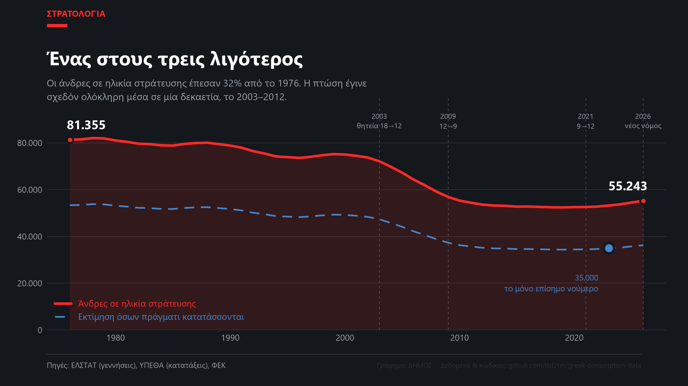
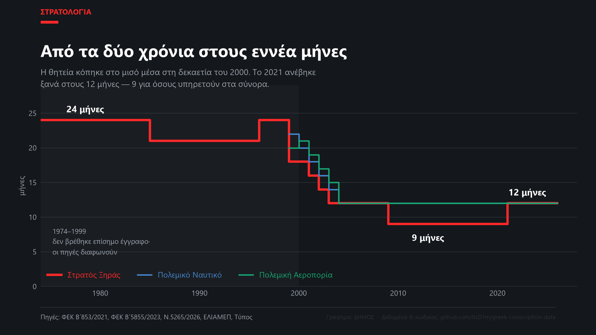
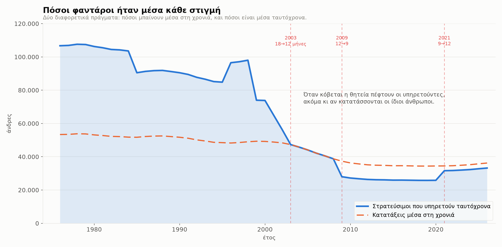
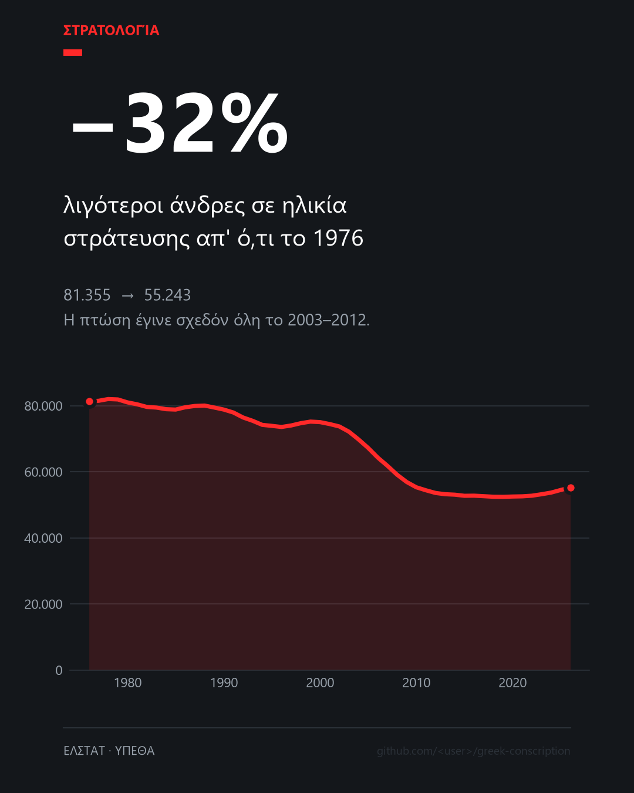

# Πόσοι άνδρες κατατάσσονται κάθε χρόνο στην Ελλάδα

Από το 1974 (Μεταπολίτευση) μέχρι σήμερα.



---

## Το βασικό

**Οι άνδρες σε ηλικία στράτευσης έπεσαν από ~81.000 το 1976 σε ~55.000 σήμερα.**
Μείωση **32%**. Ο λόγος είναι απλός: γεννιούνται λιγότερα αγόρια. Το 1955
γεννήθηκαν 85.056 αγόρια στην Ελλάδα, το 2025 γεννήθηκαν **33.633**.

Η πτώση έγινε κυρίως σε μία δεκαετία: **2003–2012** η κόκκινη γραμμή πέφτει από
73.000 σε 53.000. Είναι τα παιδιά που γεννήθηκαν την περίοδο 1980–1990, όταν
κατέρρευσε η γεννητικότητα.

Από το 2015 και μετά η γραμμή είναι **σταθερή**, γιατί οι γεννήσεις ανέβηκαν
λίγο στο 2004–2010.

## Πόσοι όμως κατατάσσονται πραγματικά;

Εδώ είναι το πρόβλημα: **ο αριθμός δεν δημοσιεύεται πουθενά.** Έψαξα ΕΛΣΤΑΤ,
Βουλή, mod.mil.gr, stratologia.gr, το Μητρώο του Δημοσίου, και το νομοσχέδιο
του 2026 (220 σελίδες). Βρήκα **ένα** νούμερο:

> «Με μέσο όρο καταταχθέντων ανά έτος **35.000** την τελευταία πενταετία…»
> — στοιχεία ΥΠΕΘΑ, Δεκ 2025

Αυτό είναι η μπλε κουκκίδα στο γράφημα. **Το 66% της κοόρτης.**
Η μπλε διακεκομμένη γραμμή είναι αυτό το ποσοστό εφαρμοσμένο σε όλα τα
χρόνια — **εκτίμηση, όχι μέτρηση**.

**Πού πάει το υπόλοιπο 34%;** Τα ίδια στοιχεία ΥΠΕΘΑ το λένε: **16.500 τον
χρόνο** χάνονται σε ανυποταξία κατοίκων εξωτερικού (22.000 στην πενταετία) και
απαλλαγές υγείας (46.000 στην πενταετία, τα 3/4 για ψυχικούς λόγους).

---

## Η θητεία



| Χρονιά | Στρατός Ξηράς | Τι έγινε |
|---|---|---|
| ως ~1985 | 24 μήνες | — |
| 1985 | 21 μήνες | επί ΠΑΣΟΚ |
| 1999 | 18 μήνες | — |
| 2001–2003 | 16 → 14 → **12** | μείωση 2 μήνες/χρόνο |
| 2009 | **9 μήνες** | — |
| 2021 | **12 μήνες** | 9 μήνες στα σύνορα |
| 2026 | 12 μήνες | νέος νόμος, όλοι στον Στρατό Ξηράς |

**Προσοχή σε ένα μπέρδεμα:** κατά *νόμο* η θητεία ήταν **24 μήνες από το 1988
μέχρι το 2026**. Αυτό που άλλαζε ήταν ο *πραγματικός* χρόνος απόλυσης, με
υπουργική απόφαση. Γι' αυτό διαφορετικές πηγές λένε διαφορετικά νούμερα για την
ίδια χρονιά.

**1974–1999: δεν βρήκα επίσημο έγγραφο.** Οι πηγές διαφωνούν — άλλη λέει
«24 μήνες ως το 1985», άλλη «22-24-26 στη δεκαετία '80», το ΕΛΙΑΜΕΠ λέει
«24 μήνες μετά τα Ίμια (1996)». Τα κράτησα όλα στο αρχείο με σημείωση
«ΑΒΕΒΑΙΟ». Δεν συμπλήρωσα τίποτα με εικασία.

---

## Ροή ≠ απόθεμα



Δύο διαφορετικά πράγματα που συχνά μπερδεύονται:

- **Κατατάξεις** = πόσοι μπαίνουν μέσα στη χρονιά (~35.000)
- **Υπηρετούντες** = πόσοι είναι μέσα ταυτόχρονα

Το 1980 κατατάσσονταν ~53.000 αλλά υπηρετούσαν ~107.000 ταυτόχρονα, γιατί η
θητεία ήταν 24 μήνες — δύο σειρές μέσα μαζί. Σήμερα κατατάσσονται ~36.000 και
υπηρετούν ~33.000.

**Το 2003–2009 οι υπηρετούντες έπεσαν από 47.000 σε 28.000** (−41%) ενώ οι
κατατάξεις έπεσαν μόνο **21%**. Η διαφορά είναι όλη από το κόψιμο της θητείας
(12 → 9 μήνες).

---

## Από πού είναι τα νούμερα

| Τι | Πηγή |
|---|---|
| Γεννήσεις αγοριών 1956–2025 | **ΕΛΣΤΑΤ**, Φυσική Κίνηση Πληθυσμού — [statistics.gr](https://www.statistics.gr/el/statistics/-/publication/SPO03/1932) |
| Γεννήσεις 1950–1955 | **UN WPP 2024** (η ΕΛΣΤΑΤ δεν δίνει φύλο για 1939–1955, λόγω πολέμου/εμφυλίου) |
| 35.000 κατατάξεις/χρόνο | Στοιχεία **ΥΠΕΘΑ**, Δεκ 2025 — [Defence Review](https://defencereview.gr/protofanis-katastasi-16-500-neoi-ton-chrono) |
| Αλλαγές θητείας 2021, 2023 | **ΦΕΚ Β΄853/2021**, **ΦΕΚ Β΄5855/2023** |
| Νέος νόμος 2026 | **Ν.5265/2026 (ΦΕΚ Α΄3/10-01-2026)**, άρθρα 176 & 244 |
| Θητεία 2000–2009 | ellinikos-stratos, ΕΛΙΑΜΕΠ (χωρίς ΦΕΚ) |

**Κάθε νούμερο στα αρχεία έχει πηγή και ημερομηνία. Τίποτα δεν είναι
επινοημένο.** Όπου λείπει χρονιά, το κελί είναι κενό.

---

## Τι δεν λέει αυτό

- **Δεν κάνει καμία πρόβλεψη για το μέλλον.** Σταματά στο σήμερα.
- **Η μπλε διακεκομμένη γραμμή είναι εκτίμηση.** Με ένα μόνο πραγματικό νούμερο, το 66%
  εφαρμόζεται σε όλα τα χρόνια. Στη δεκαετία του '80 ήταν μάλλον υψηλότερο
  (λιγότερες απαλλαγές, λιγότεροι έφευγαν στο εξωτερικό) — άρα η γραμμή
  **υποεκτιμά** τα παλιά χρόνια.
- **Δεν αφαιρεί όσους μετανάστευσαν** στη δεκαετία του 2010, ούτε προσθέτει
  ομογενείς και πολιτογραφημένους.
- **Το 1974–1975 λείπει** γιατί χρειάζονται γεννήσεις του 1948–1949 που δεν
  υπάρχουν πουθενά.

---

## Το στυλ των γραφημάτων

Τα PNG είναι φτιαγμένα για να **ανεβαίνουν αυτούσια σε site ή σε social**:
σκούρο φόντο, κόκκινο σήμα, τίτλος και πηγές μέσα στην εικόνα. Δεν χρειάζονται
λεζάντα από κάτω — στέκονται μόνα τους.

| Αρχείο | Μέγεθος | Πού |
|---|---|---|
| `01_katataxeis.png` | 1920×1080 | μέσα στο άρθρο |
| `02_diarkeia_thiteias.png` | 1920×1080 | μέσα στο άρθρο |
| `03_ypiretountes.png` | 1920×1080 | μέσα στο άρθρο |
| `04_social_vertical.png` | 1080×1350 | Instagram / Facebook |



**Άλλαξε την υπογραφή σου** στη γραμμή `CREDIT` στο `scripts/make_figures.py`.
Τα χρώματα (`BG`, `RED`, `BLUE`, `GREEN`) είναι από πάνω στο ίδιο αρχείο —
η τριάδα περνάει όλους τους ελέγχους αναγνωσιμότητας (και για αχρωματοψία)
πάνω στο σκούρο φόντο.

---

## Πώς τρέχει

```bash
python -m venv .venv
.venv/Scripts/activate          # Windows
pip install -r requirements.txt

python scripts/fetch_births.py     # κατεβάζει ΕΛΣΤΑΤ + UN WPP
python scripts/build_observed.py
python scripts/model.py
python scripts/make_figures.py     # -> figures/
```

Ή όλο μαζί: `jupyter notebook notebooks/analysis.ipynb`

Αν σκάσει με `CERTIFICATE_VERIFY_FAILED` φταίει ο Avast — το `truststore` το
λύνει και είναι ήδη μέσα.

## Τα αρχεία

```
data/processed/
├── births_male.csv           γεννήσεις αγοριών ανά έτος
├── conscripts_observed.csv   ό,τι βρέθηκε με πηγή
├── service_timeline.csv      διάρκεια θητείας ανά περίοδο
└── model_output.csv          το αποτέλεσμα
```
